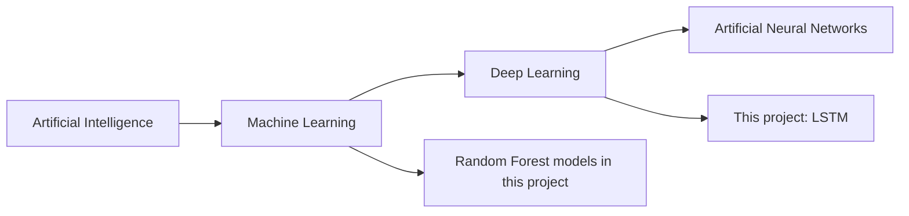
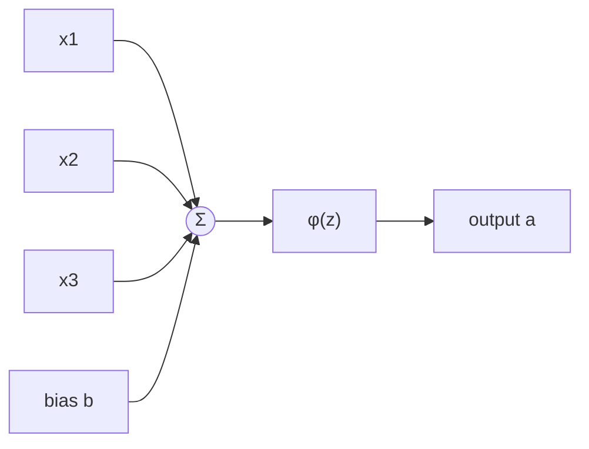
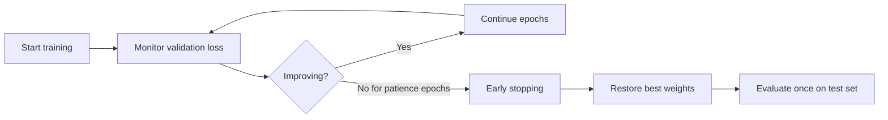

# 01 — Deep Learning Fundamentals

**THEORETICAL BACKGROUND.** This document explains the general concepts needed to understand the shipped LSTM. Section 1.14 states which of these ideas are actually visible in this project.

---

## 1.1 Artificial Intelligence, Machine Learning, Deep Learning and ANN

| Term | Definition | Example |
|---|---|---|
| **Artificial Intelligence (AI)** | Any technique that enables machines to mimic human cognitive functions such as learning, reasoning and decision-making. | A chess engine, a spam filter, a chatbot. |
| **Machine Learning (ML)** | A subset of AI in which systems learn patterns from data instead of being explicitly programmed with rules. | Linear regression, decision trees, Random Forest, SVM. |
| **Deep Learning (DL)** | A subset of ML based on multi-layer neural networks that learn hierarchical representations automatically. | CNNs for images, RNN/LSTM for sequences, Transformers for text. |
| **Artificial Neural Network (ANN)** | The computational model used by DL: interconnected nodes (neurons) with learnable weights, organised in layers. | A multilayer perceptron (MLP). |

**Project link (VERIFIED):** this repository contains both ML and DL models. `models/model_metadata.json` documents a `RandomForestClassifier`; `models/lstm_metadata.json` documents the LSTM. The deep-learning part of the project is the LSTM.

**Viva Q:** *Is every neural network deep learning?* No. A network with one hidden layer is an ANN but usually not called "deep"; DL implies multiple stacked layers that learn progressively richer features. The shipped model has two recurrent layers plus two Dense layers, so it qualifies as deep.

---

## 1.2 The artificial neuron

A biological-inspired unit that takes inputs, weights them, adds a bias, and passes the result through an activation function.

For inputs $x_1,\dots,x_n$, weights $w_1,\dots,w_n$, bias $b$:

$$
z = \sum_{i=1}^{n} w_i x_i + b = \mathbf{w}^\top \mathbf{x} + b
$$
$$
a = \phi(z)
$$

where $\phi$ is the activation function and $a$ is the neuron's output.

**Why weights and bias?**
- **Weights** control the influence and sign (excitatory/inhibitory) of each input.
- **Bias** shifts the activation threshold, letting the neuron fire even when all inputs are zero.

**Numerical example — hypothetical, not from the model:**
Let $\mathbf{x} = [0.8, 0.2]$, $\mathbf{w} = [1.5, -0.5]$, $b = -0.1$, $\phi = \text{sigmoid}$.

$z = 1.5(0.8) + (-0.5)(0.2) - 0.1 = 1.2 - 0.1 - 0.1 = 1.0$
$a = \sigma(1.0) = 1/(1+e^{-1}) \approx 0.731$.

If we used $\phi = \text{ReLU}$, $a = \max(0, 1.0) = 1.0$.

---

## 1.3 Forward propagation

Forward propagation is the computation of outputs layer by layer, from input to prediction, with no learning involved.

For layer $l$:

$$
\mathbf{z}^{(l)} = \mathbf{W}^{(l)} \mathbf{a}^{(l-1)} + \mathbf{b}^{(l)}, \qquad
\mathbf{a}^{(l)} = \phi^{(l)}(\mathbf{z}^{(l)})
$$

The final layer's activation defines the task output: sigmoid for binary probability, softmax for multiclass, linear for regression.

**Project link (VERIFIED):** a forward pass through the shipped model is `model.predict(X)` in `scripts/predict_lstm.py` line 255 and `scripts/lstm_inference.py` line 510. During the read-only audit, `predict()` on a zero array produced output shape `(2, 1)` and **all weights were identical before and after** — direct evidence that inference is a pure forward pass.

---

## 1.4 Activation functions

| Function | Formula | Range | Use |
|---|---|---|---|
| Sigmoid | $\sigma(z)=\dfrac{1}{1+e^{-z}}$ | $(0,1)$ | Binary probability; gates in LSTM |
| Tanh | $\tanh(z)=\dfrac{e^{z}-e^{-z}}{e^{z}+e^{-z}}$ | $(-1,1)$ | Zero-centred hidden state; candidate cell state |
| ReLU | $\max(0,z)$ | $[0,\infty)$ | Hidden Dense layers; avoids vanishing gradient for positive z |
| Leaky ReLU | $\max(\alpha z, z),\ \alpha\ll1$ | $(-\infty,\infty)$ | Avoids "dying ReLU" |
| Softmax | $\dfrac{e^{z_i}}{\sum_j e^{z_j}}$ | $(0,1)$, sums to 1 | Multiclass probabilities |

**Why not linear activations everywhere?** Stacking linear layers collapses into a single linear transform, so the network could not model non-linear relationships. Non-linear activations give universal approximation capability.

**Project link (VERIFIED):** the checkpoint uses `tanh` for LSTM candidate/state transformations, `sigmoid` for LSTM gates and the output neuron, and `relu` for the intermediate `Dense(32)` layer (`config.json` inspection, audit §10.4). Softmax and Leaky ReLU are **not used**.

**Viva Q:** *Why sigmoid at the output?* Because the target is a binary label and sigmoid maps any real number to a value in (0,1) that can be interpreted as $P(\text{UP})$. A linear output could produce values outside [0,1].

---

## 1.5 Loss functions

A loss function measures the discrepancy between prediction and target; training minimises it.

| Task | Typical loss | Formula |
|---|---|---|
| Binary classification | Binary cross-entropy | $\mathcal{L}=-\frac{1}{N}\sum_{i=1}^{N}\left[y_i\log \hat y_i+(1-y_i)\log(1-\hat y_i)\right]$ |
| Multiclass | Categorical cross-entropy | $-\sum_c y_c \log \hat y_c$ |
| Regression | MSE / Huber | $\frac{1}{N}\sum (y-\hat y)^2$ / robust variant |

**Intuition:** cross-entropy heavily penalises confident wrong answers. If the true label is 1 and the model predicts 0.1, the term $-\log(0.1)\approx2.30$; if it predicts 0.9, $-\log(0.9)\approx0.105$.

**Numerical example — hypothetical:** targets $y=[1,0]$, predictions $\hat y=[0.8,0.3]$.
$\mathcal{L}=-[1\log0.8 + 0\log0.2 + 0\log0.3 + 1\log0.7]/2$
$= -[-0.2231 -0.3567]/2 = 0.2899$.

**Project link (VERIFIED):** `config.json → compile_config.loss = "binary_crossentropy"`; also `scripts/train_lstm_model.py` line 196. Phase 3 design (not shipped) uses sparse categorical cross-entropy + Huber (`scripts/phase3_config.py` lines 75–81).

---

## 1.6 Backpropagation and gradient descent

**Backpropagation** applies the chain rule to compute the gradient of the loss with respect to every weight, layer by layer from output back to input:

$$
\frac{\partial \mathcal{L}}{\partial w^{(l)}} = \frac{\partial \mathcal{L}}{\partial a^{(L)}}\cdot
\frac{\partial a^{(L)}}{\partial z^{(L)}}\cdots\frac{\partial z^{(l)}}{\partial w^{(l)}}
$$

**Gradient descent** updates weights in the direction that reduces loss:

$$
w \leftarrow w - \eta \frac{\partial\mathcal{L}}{\partial w}
$$

where $\eta$ is the learning rate. If $\eta$ is too large, training diverges; too small, learning is slow.

Variants: batch GD (all data), stochastic GD (one sample), mini-batch GD (small batches) — see document 08, table 9.

**Project link (VERIFIED):** the checkpoint stores Adam optimizer state with `learning_rate = 0.00025`, `beta_1=0.9`, `beta_2=0.999`, `epsilon=1e-7`. Metadata records a configured 0.001; the difference is consistent with `ReduceLROnPlateau` halving the LR during training before the best checkpoint was saved (inference, not proven — see audit §10.7).

---

## 1.7 Epochs, batches and iterations

| Term | Meaning |
|---|---|
| **Epoch** | One complete pass over the training set. |
| **Batch size** | Number of samples processed before one weight update. |
| **Iteration** | One weight update; iterations per epoch = $\lceil N_\text{train}/\text{batch size}\rceil$. |

**Project link (VERIFIED):** `models/lstm_metadata.json` lines 51–55 record `epochs_configured=30`, `epochs_trained=29`, `batch_size=32`, `early_stopping=true`. With 29 epochs and ~3,000 training sequences there would be roughly 90+ iterations per epoch; the exact training sample count is **NOT AVAILABLE** (metadata has no partition report).

**Why early stopping?** Training is monitored on a validation set; when validation loss stops improving for several epochs, training stops and the best weights are restored — a regularisation technique against overfitting.

---

## 1.8 Overfitting, underfitting and generalisation

| Condition | Training error | Validation/test error | Cause | Fix |
|---|---|---|---|---|
| Underfitting | High | High | Model too simple / too few epochs / poor features | More capacity, better features, longer training |
| Overfitting | Low | High | Model memorises noise | Dropout, early stopping, more data, regularisation |
| Good fit | Low | Low | Learned transferable patterns | — |

**Generalisation** is the ability to perform well on unseen data. It is the goal of ML; training accuracy alone says nothing about it.

**Project link (VERIFIED):** two `Dropout(0.2)` layers and `EarlyStopping(monitor='val_loss', patience=7, restore_best_weights=True)` are present (`phase2_backup_20261124/train_lstm_model.py` lines 214–234; current `scripts/train_lstm_model.py` lines 216–236). The recorded metrics (~53% accuracy, AUC 0.537) suggest the model generalises only marginally better than chance — a weak but honest result.

---

## 1.9 Training, validation and test sets

| Split | Purpose | Touch during training? |
|---|---|---|
| Training | Compute gradients and update weights | Yes |
| Validation | Tune hyperparameters, early stopping, checkpoint selection | Read only (no gradient update) |
| Test | Final unbiased estimate of performance | Once, after model selection |

**Time-series caveat:** random shuffling leaks future information into training. Use a **chronological** split so that `train_max_date < val_min_date <= val_max_date < test_min_date`.

**Project link (VERIFIED/CAVEAT):** the shipped metadata records `chronological_80_20`. The current code uses a leakage-safe per-symbol chronological 70/15/15 split (`scripts/lstm_data_pipeline.py` lines 330–393, `scripts/train_lstm_model.py` lines 81–88). However the earlier script fitted the scaler on all data before splitting (`phase2_backup_20261124/train_lstm_model.py` lines 394–398), so the original run likely had scaler leakage. The current code fixes this by fitting on training rows only (lines 409–423).

---

## 1.10 Applying the fundamentals to this project

| Concept | Where it appears in this project |
|---|---|
| Artificial neuron | Each of the 128/64 LSTM cells and 32 Dense units performs $\mathbf{w}^\top\mathbf{x}+b$ followed by an activation |
| Weights and biases | 128,321 trainable parameters stored in `model.weights.h5` |
| Forward propagation | `model.predict(X)` — no weight updates |
| Sigmoid | LSTM gates and the single output neuron → `P(UP)` |
| Tanh | LSTM candidate state and hidden state transform |
| ReLU | `Dense(32)` |
| Binary cross-entropy | Compile config of the checkpoint |
| Backpropagation / Adam | Used only when the checkpoint was originally trained |
| Dropout / early stopping | Regularisation used during that training |
| Train/val/test | Chronological split; current code is leakage-safe |

---

## 1.11 Viva questions and answers

**Q1. Distinguish AI, ML, DL and ANN in one sentence each.**
AI is the goal of machine intelligence; ML achieves it by learning from data; DL uses multi-layer neural networks; ANN is the network architecture itself.

**Q2. Why is a bias term necessary?**
It shifts the activation threshold, allowing a neuron to activate at zero or negative weighted sums and to model offsets in the data.

**Q3. Write the equation of a neuron and explain each symbol.**
$z=\sum_i w_i x_i+b$, $a=\phi(z)$: $x_i$ inputs, $w_i$ learned weights, $b$ learned bias, $\phi$ non-linear activation, $a$ output.

**Q4. What is forward propagation and does it change weights?**
It computes predictions layer by layer; it never changes weights. This project's `model.predict()` is exactly that.

**Q5. Why sigmoid, not linear, at the output?**
Sigmoid bounds the output to (0,1), making it a valid probability for binary classification.

**Q6. What is cross-entropy and why is it preferred to accuracy as a training loss?**
Cross-entropy is differentiable and penalises confident mistakes heavily, giving useful gradients; accuracy is a discrete, non-smooth metric.

**Q7. What is the learning rate and what value is stored in this checkpoint?**
It scales weight updates. The checkpoint stores Adam with `learning_rate ≈ 2.5e-4`; metadata records a configured 0.001 (likely reduced during training).

**Q8. What is the difference between an epoch, a batch and an iteration?**
An epoch is one full pass over training data; a batch is a subset used for one update; an iteration is that update.

**Q9. How do you detect overfitting?**
Validation loss rises while training loss keeps falling. Remedies include dropout, early stopping and more data.

**Q10. Why is a chronological split essential for stock data?**
Random splits put future sessions in training, leaking information and inflating test scores.

**Q11. What does generalisation mean and does this model generalise well?**
Performance on unseen data. The recorded test accuracy ≈ 53% and AUC ≈ 0.537 indicate only weak generalisation.

**Q12. Is accuracy a good metric here? Why?**
No. With roughly half the labels UP, a majority-class predictor already gets ~53%. AUC, precision/recall and the confusion matrix are more informative.

**Q13. What regularisation is used in this project?**
Dropout(0.2) after both LSTM layers, plus early stopping on validation loss.

**Q14. (Tricky) The dashboard shows 53% accuracy. Does that prove the model learned nothing?**
Not proof of "nothing", but ROC AUC ≈ 0.537 is near chance, so evidence of useful skill is weak. Report both numbers with the class-imbalance caveat.

**Q15. (Tricky) If inference changes the model's weights, what would that mean?**
It would mean training is happening at prediction time. In this project it does not; the audit verified weights are unchanged after `predict()`.

**Q16. Why use ReLU in the Dense layer but sigmoid at the output?**
ReLU gives sparse, non-saturating hidden representations; sigmoid produces a bounded probability suitable for a binary decision.

**Q17. What is backpropagation through time? (detail in doc 07)**
Backpropagation applied across the unrolled sequence of an RNN/LSTM; gradients flow through each timestep.

**Q18. What is a checkpoint?**
A saved snapshot of model architecture and weights (here `models/lstm_model.keras`, 1.58 MB), allowing reuse without retraining.

**Q19. Why not retrain the model on every dashboard run?**
Retraining is slow, non-deterministic, would overwrite the deployed artifact and violate the project's "existing-model inference" design.

**Q20. Where does the 21-feature schema come from?**
`scripts/model_config.py` lines 28–50; it is cross-checked against metadata and the data pipeline at startup (`scripts/lstm_inference.py` lines 185–195).
