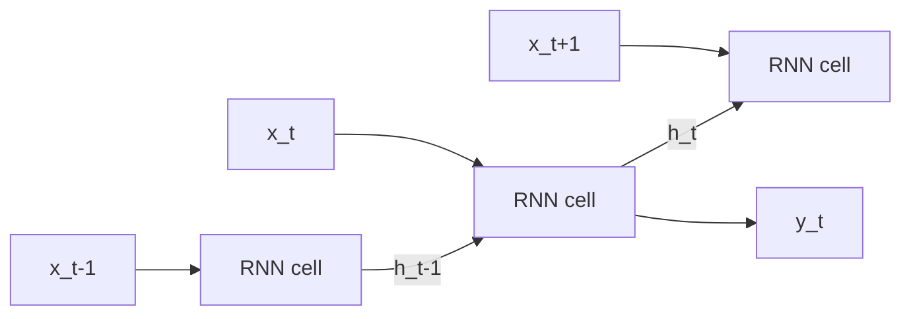
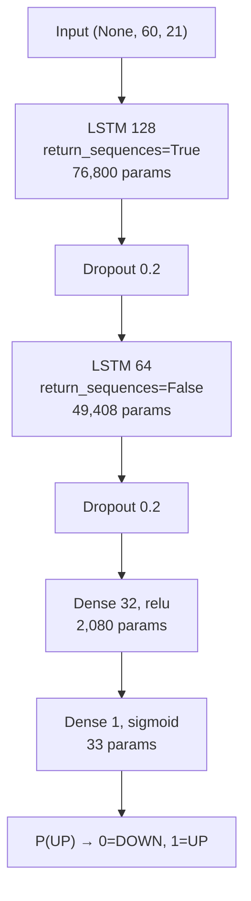

# 02 — RNN and LSTM Architecture

**THEORETICAL BACKGROUND** with a clearly marked VERIFIED section describing the exact saved model.

---

## 2.1 What is sequential data?

Data where observation order matters and each sample depends on previous samples. A stock's close on Tuesday is related to its close on Monday; shuffling the rows destroys that structure.

| Data type | Sequential? | Example |
|---|---|---|
| Image pixels | Spatially structured, not sequential in time | Cat vs dog |
| Tabular snapshot | No | One day's PE ratio |
| Stock OHLCV history | **Yes** | 60 consecutive trading sessions |
| Speech / text | **Yes** | Words in a sentence |

A **time series** is sequential data indexed by time. **Time-series forecasting** predicts a future value or state from past observations.

**Project link (VERIFIED):** each input sample is one symbol's last 60 chronological sessions (`scripts/predict_lstm.py` lines 151–179), never a mixture of symbols.

---

## 2.2 Why stock-market data needs sequential treatment

1. **Temporal dependence:** today's momentum derives from prior days' returns.
2. **Indicators are path-dependent:** EMA, MACD and RSI are recursive functions of earlier prices (`scripts/lstm_data_pipeline.py` lines 152–172).
3. **Regime context:** volatility and trend evolve over time; a single snapshot cannot express "rising then consolidating".
4. **No independent-sample assumption:** consecutive sessions are correlated, so a model that sees only one row misses the pattern.

A feed-forward ANN on one row treats every day as independent; an RNN/LSTM carries information across the window.

---

## 2.3 Recurrent Neural Network (RNN)

An RNN reuses the same weight matrix at every timestep and keeps a hidden state $h_t$ that summarises the past.

$$
h_t = \phi(W_x x_t + W_h h_{t-1} + b), \qquad y_t = g(W_y h_t + c)
$$

**Weight sharing** is the key idea: the same parameters are applied at all timesteps, so the model can generalise to different sequence positions and has far fewer parameters than a separate network per timestep.

**Example:** to predict direction for session $t$, an RNN reads sessions $t-59\dots t$ and its final hidden state encodes the window.

---

## 2.4 Limitations of vanilla RNNs

### Vanishing gradient
During backpropagation through time, the gradient of early timesteps contains products of the recurrent weight matrix and activation derivative:

$$
\frac{\partial h_T}{\partial h_1} = \prod_{t=2}^{T} \frac{\partial h_t}{\partial h_{t-1}}
$$

If the dominant eigenvalues are $<1$, this product shrinks exponentially across 60 steps. Early sessions (e.g. day $t-59$) then contribute almost nothing to learning. In stocks, this would mean a 60-day window effectively remembers only the last few days.

### Exploding gradient
If the factors are $>1$, gradients grow exponentially and weight updates become unstable. **Gradient clipping** is the usual remedy.

### Why this matters here
A 60-timestep window is long enough that a plain RNN would struggle to preserve information from the beginning of the window (e.g. a volume spike 50 sessions ago). LSTMs were designed specifically to address this.

---

## 2.5 Why LSTM was developed

Hochreiter & Schmidhuber (1997) introduced the **Long Short-Term Memory** cell with an explicit, additive **cell state** and gated write/read/erase operations. The additive update $C_t = f_t\odot C_{t-1} + i_t\odot\tilde C_t$ gives gradients a near-constant error path, so information can persist across many timesteps without vanishing.

---

## 2.6 RNN vs LSTM

| Property | Vanilla RNN | LSTM |
|---|---|---|
| State | One hidden state $h_t$ | Hidden state $h_t$ **plus** cell state $C_t$ |
| Update | $h_t=\phi(Wx+Wh_{t-1})$ | Gated additive cell-state update |
| Parameters per unit | ~$n^2+n$ | ~$4(n^2+n)$ (4 gates) |
| Long dependencies | Poor | Good |
| Vanishing gradient | Severe | Mitigated |
| Training cost | Lower | ~4× higher |

**Project link (VERIFIED):** the checkpoint's first LSTM has 76,800 parameters for 128 units (4 × 128 × (21+128) + 4 × 128 ≈ 76,800), matching the 4-gate structure.

---

## 2.7 LSTM vs GRU

| Property | LSTM | GRU (THEORETICAL — not used here) |
|---|---|---|
| Gates | Forget, input, output (3) + candidate | Reset, update (2) + candidate |
| States | $h_t$ and $C_t$ | Only $h_t$ |
| Parameters | More | ~25–40% fewer |
| Training speed | Slower | Faster |
| Performance | Often better on long dependencies | Often comparable; better with limited data |

**Project answer:** GRU is a valid alternative, but the shipped checkpoint is LSTM, so GRU is theoretical background only. You should not claim the project uses GRU.

---

## 2.8 Why LSTM is suitable for this project

1. **60-step context:** captures trends over roughly a trading quarter.
2. **Selective memory:** the forget gate can discard stale patterns; the input gate can emphasise a recent breakout.
3. **Recursive indicators already encode history:** SMA/EMA/MACD/RSI are themselves temporally dependent; feeding them as a sequence lets the model learn how those indicators evolve, not just their latest value.
4. **Gated nonlinearity:** richer than a fixed moving-average rule.

**Important nuance (VERIFIED):** "suitable" does not mean "accurate". Recorded metrics are accuracy 0.532 and ROC AUC 0.537 — weak signal. The architecture choice is defensible; the result is modest.

---

## 2.9 Limitations of LSTM for stock prediction

1. **Noisy, near-random signal:** prices are influenced by news and exogenous events absent from the input.
2. **Non-stationarity:** market regimes change; weights trained on 2020–2026 data may not transfer.
3. **Class imbalance:** UP labels dominate the test set (2006 vs 1790), biasing predictions toward UP.
4. **Fixed window:** 60 sessions cannot see longer cycles.
5. **No attention:** every timestep is compressed into a final vector (second LSTM), so distant details can be diluted.
6. **Scaler sensitivity:** predictions depend on the fitted value range; extreme live values fall outside it.
7. **Binary only:** no magnitude or three-way direction.
8. **No transaction costs or uncertainty calibration** in the output.

---

## 2.10 Exact architecture of the shipped checkpoint (VERIFIED)

Source: `config.json` inside `models/lstm_model.keras`; confirmed with `keras.models.load_model()` and `model.summary()` (audit §10.4).

| Layer | Units | Return sequence | Dropout | Activation | Output | Params |
|---|---:|---|---:|---|---|---:|
| Input | — | — | — | — | `(None,60,21)` | 0 |
| LSTM 1 | 128 | **True** | 0.0 internal; followed by Dropout(0.2) | tanh / sigmoid gates | `(None,60,128)` | 76,800 |
| Dropout | — | — | 0.2 | — | `(None,60,128)` | 0 |
| LSTM 2 | 64 | **False** | 0.0 internal; followed by Dropout(0.2) | tanh / sigmoid gates | `(None,64)` | 49,408 |
| Dropout | — | — | 0.2 | — | `(None,64)` | 0 |
| Dense | 32 | — | — | relu | `(None,32)` | 2,080 |
| Dense output | 1 | — | — | sigmoid | `(None,1)` | 33 |

**Total: 128,321 trainable parameters; 0 non-trainable.**

### Why `return_sequences=True` on the first LSTM
The second LSTM expects a 3-D input `(batch, timesteps, features)`. If the first LSTM returned only its final state `(batch, 128)`, stacking a second LSTM would be impossible. `return_sequences=True` passes all 60 hidden vectors forward.

### Why the second LSTM has `return_sequences=False`
It compresses the 60-step sequence into one 64-dimensional vector — the learned summary of the whole window — which the Dense head can classify.

### Dropout placement
The two `Dropout(0.2)` layers are **separate Keras layers** (rate 0.2). The LSTM layers' own `dropout` and `recurrent_dropout` parameters are both **0.0** in the checkpoint — an important distinction for viva precision. Dropout is active only during training; at inference it is inactive.

### Additional verified LSTM cell settings
`use_bias=True`, `unit_forget_bias=True` (forget-gate bias initialised to 1 at training time), `go_backwards=False`, `stateful=False`, `unroll=False`, `implementation=2`, GlorotUniform input kernels, Orthogonal recurrent kernels. Initializers affect only training, not inference.

---

## 2.11 Viva questions and answers

**Q1. Why did you choose LSTM over a simple ANN?**
Stock data is sequential; an ANN on a single row cannot model trends across days. LSTM carries a hidden and cell state across the 60-session window.

**Q2. What is a vanishing gradient?**
Gradients shrink multiplicatively across timesteps, so early inputs barely influence learning. LSTM's additive cell state mitigates it.

**Q3. How does an LSTM solve it?**
The forget/input gates regulate an additive cell-state update $C_t=f_tC_{t-1}+i_t\tilde C_t$, providing a near-constant gradient path.

**Q4. What is the difference between RNN and LSTM?**
RNN has one recurrent hidden state and no gates; LSTM adds a cell state and three gates controlling write, erase and read.

**Q5. LSTM vs GRU?**
GRU uses two gates and no separate cell state, so it is cheaper; the project uses LSTM, not GRU.

**Q6. Why two LSTM layers instead of one?**
The first (128 units) extracts rich per-timestep features; the second (64 units) compresses them into one context vector. Stacking increases representational capacity.

**Q7. What does `return_sequences=True` do and why is it needed here?**
It returns the hidden state at every timestep; without it the second LSTM could not receive a sequence.

**Q8. Why is the second LSTM's `return_sequences=False`?**
We need a single vector for the Dense classifier, not 60 vectors.

**Q9. Where is dropout used and what is its rate?**
Two standalone Dropout layers with rate 0.2, after each LSTM. The LSTMs' internal dropout rates are 0.0.

**Q10. Is dropout active during prediction?**
No. It is a training-only regularisation; `model.predict()` does not drop units.

**Q11. What are the shapes between layers?**
`(None,60,21) → (None,60,128) → (None,60,128) → (None,64) → (None,64) → (None,32) → (None,1)`.

**Q12. How many parameters and how is the first LSTM's count derived?**
128,321 total. First LSTM: 4 gates × 128 units × (21 inputs + 128 recurrent weights) + 4×128 biases = 76,800.

**Q13. Can the model remember a spike from day 1 of the 60-day window?**
In principle yes through the cell state, but in practice a 60-step window and weak gradients may dilute it; this is a limitation, not a guarantee.

**Q14. Does bidirectional LSTM appear in the project?**
No. `go_backwards=False` and there is no `Bidirectional` wrapper. Bidirectional processing would be inappropriate for causal forecasting anyway.

**Q15. Why not a CNN for this task?**
A 1-D CNN can extract local patterns but lacks the explicit long-term state of an LSTM. CNNs are not used here (see comparison table in doc 08).

**Q16. What is stateful LSTM and is it used?**
A stateful LSTM carries state between separate calls. Here `stateful=False`; each prediction uses one self-contained 60-day window.

**Q17. Does the model output hidden states?**
No. `return_state=False`; only the final sigmoid probability is returned.

**Q18. What is the biggest weakness of LSTM for stocks?**
Non-stationary, noisy data and weak recorded signal (AUC ≈ 0.537); architecture alone cannot create information that is not in the features.

**Q19. (Tricky) Your first LSTM has 128 units and the second has 64. Does that mean it is an encoder–decoder?**
No. An encoder–decoder has a separate decoder generating outputs; this is a stacked recurrent classifier with a final Dense head.

**Q20. (Tricky) If you set `return_sequences=True` on the second LSTM, what would break?**
Its output would be `(None,60,64)`, which a `Dense(1, sigmoid)` would apply to every timestep, producing 60 probabilities instead of one; the output contract `(None,1)` would be violated.

**Q21. (Tricky) Is the 60-day window scientifically optimal?**
No evidence of that. 60 is the configuration of the existing checkpoint; no hyperparameter search for sequence length is recorded.

**Q22. (Tricky) Could this model be trained on all 5,884 stocks?**
The current trainer processes all eligible symbols, but the **shipped** checkpoint's metadata lists five stable symbols. Do not claim the deployed model was trained on thousands of stocks.
