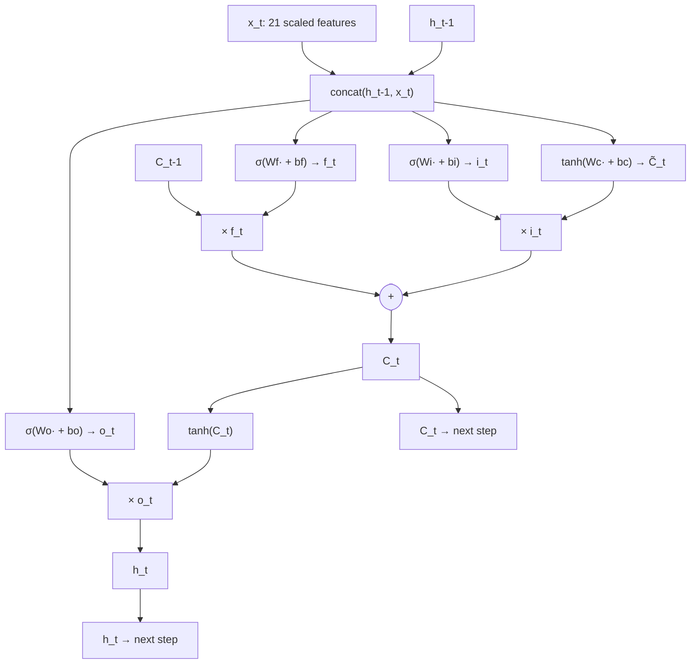

# 03 — LSTM Mathematics

Two separate things must not be confused:

- **Section 3.1–3.6:** the *general* LSTM cell equations (textbook theory).
- **Section 3.7:** the *exact* layer configuration verified in this project's checkpoint.

---

## 3.1 Variables and notation

| Symbol | Meaning |
|---|---|
| $x_t \in \mathbb{R}^{d}$ | Input vector at timestep $t$ (here: 21 scaled features for one session) |
| $h_{t-1} \in \mathbb{R}^{n}$ | Previous hidden state (short-term output) |
| $C_{t-1} \in \mathbb{R}^{n}$ | Previous cell state (long-term memory) |
| $f_t \in (0,1)^n$ | Forget gate: how much of the old cell state to keep |
| $i_t \in (0,1)^n$ | Input gate: how much new information to write |
| $\tilde C_t \in (-1,1)^n$ | Candidate cell state (new information proposed) |
| $o_t \in (0,1)^n$ | Output gate: how much cell state to expose |
| $W_*, U_*, b_*$ | Learned weights/biases for each gate ($U$ = recurrent weights on $h_{t-1}$) |
| $[\,h_{t-1},x_t\,]$ | Concatenation of previous hidden state and current input |
| $\sigma$ | Sigmoid, $\sigma(z)=1/(1+e^{-z})$ — gate values in (0,1) |
| $\tanh$ | Hyperbolic tangent, output in (−1,1) — zero-centred content |
| $\odot$ | Element-wise (Hadamard) multiplication — per-dimension gating |

---

## 3.2 The seven LSTM equations

$$
\text{(1) Forget gate:}\quad f_t = \sigma\big(W_f[h_{t-1},x_t]+b_f\big)
$$

$$
\text{(2) Input gate:}\quad i_t = \sigma\big(W_i[h_{t-1},x_t]+b_i\big)
$$

$$
\text{(3) Candidate state:}\quad \tilde C_t = \tanh\big(W_c[h_{t-1},x_t]+b_c\big)
$$

$$
\text{(4) Cell state:}\quad C_t = f_t\odot C_{t-1} + i_t\odot \tilde C_t
$$

$$
\text{(5) Output gate:}\quad o_t = \sigma\big(W_o[h_{t-1},x_t]+b_o\big)
$$

$$
\text{(6) Hidden state:}\quad h_t = o_t\odot \tanh(C_t)
$$

$$
\text{(7) Output at final step:}\quad \hat y = \sigma(W_y h_T + b_y)
$$

Equation (7) corresponds to this project's final `Dense(1, sigmoid)` layer applied after the last LSTM step.

---

## 3.3 What each gate does, intuitively

| Gate | Question it answers | Stock-market interpretation |
|---|---|---|
| Forget $f_t$ | "Which parts of the long-term memory are still relevant?" | Discard a month-old breakout pattern; keep the recent volatility regime. |
| Input $i_t$ | "Is today's new information worth storing?" | A sharp volume spike may be written to memory; a quiet day may not. |
| Candidate $\tilde C_t$ | "What new content could be stored?" | Today's feature vector mapped into memory space. |
| Cell state $C_t$ | "What does the model remember so far?" | Running summary of trend/momentum/volatility. |
| Output $o_t$ | "Which memories should influence the prediction now?" | Expose trend information relevant to tomorrow's direction. |
| Hidden $h_t$ | "What is the current output-facing summary?" | Vector passed to the next timestep and, at the end, to the Dense head. |

**Why sigmoid for gates?** Values near 0 mean "close fully", near 1 "open fully", so gates act as soft switches and remain differentiable.

**Why tanh for candidate/state?** It is zero-centred, so updates can be positive or negative and the state does not drift monotonically upward.

**Why element-wise multiplication?** It lets each memory dimension be controlled independently: a single gate vector can selectively keep some dimensions and erase others.

---

## 3.4 Numerical walk-through (HYPOTHETICAL — not model values)

One-dimensional illustration: $C_0=0.5$, $h_0=0.2$. Chosen weights are arbitrary and exist only to demonstrate arithmetic.

**Session t ($x_t=0.8$):**

- $f_t=\sigma(1.0\cdot0.8+0.5\cdot0.2-0.2)=\sigma(0.8)=0.690$
- $i_t=\sigma(0.5\cdot0.8-0.2\cdot0.2+0.1)=\sigma(0.46)=0.613$
- $\tilde C_t=\tanh(0.7\cdot0.8+0.3\cdot0.2)=\tanh(0.62)=0.552$
- $C_t = 0.690\times0.5 + 0.613\times0.552 = 0.345+0.338 = 0.683$
- $o_t=\sigma(0.6\cdot0.8+0.4\cdot0.2-0.1)=\sigma(0.46)=0.613$
- $h_t = 0.613\times\tanh(0.683)=0.613\times0.594=0.364$

**Session t+1 ($x_{t+1}=0.3$):**

- $f_t=\sigma(0.3+0.5\cdot0.364-0.2)=\sigma(0.282)=0.570$
- $i_t=\sigma(0.15-0.2\cdot0.364+0.1)=\sigma(0.177)=0.544$
- $\tilde C_t=\tanh(0.7\cdot0.3+0.3\cdot0.364)=\tanh(0.319)=0.309$
- $C_t = 0.570\times0.683 + 0.544\times0.309 = 0.389+0.168=0.557$
- $o_t=\sigma(0.6\cdot0.3+0.4\cdot0.364-0.1)=\sigma(0.226)=0.556$
- $h_t=0.556\times\tanh(0.557)=0.556\times0.505=0.281$

**Reading the story:** at session t a strong input (0.8) is partly written into memory, raising $C$ from 0.5 to 0.683. At t+1 the forget gate keeps 57% of that memory while a weaker new signal is added, so $C$ decays to 0.557. This is exactly the "retain vs overwrite" behaviour the gates provide.

---

## 3.5 Backpropagation through time (BPTT)

The unrolled LSTM is trained by applying the chain rule across timesteps. For the cell state:

$$
\frac{\partial C_t}{\partial C_{t-1}} = f_t + \underbrace{\frac{\partial f_t}{\partial C_{t-1}}\odot C_{t-1} + \frac{\partial i_t}{\partial C_{t-1}}\odot \tilde C_t + \frac{\partial \tilde C_t}{\partial C_{t-1}}\odot i_t}_{\text{additional paths}}
$$

The direct $f_t$ term is why gradients can flow over long distances: when $f_t\approx1$, the gradient passes through almost unchanged. That is the mathematical core of "long short-term memory". When $f_t\approx0$, the path is cut — the model deliberately forgets.

BPTT is used **only during training**. Inference in this project calls `model.predict()` and performs forward computation only.

---

## 3.6 Parameter count derivation (VERIFIED)

For an LSTM layer with input dimension $d$, $n$ units, and 4 gates:

$$
\text{params} = 4n(d+n) + 4n
$$

- Layer 1: $d=21$, $n=128$ → $4\cdot128\cdot(21+128)+4\cdot128 = 76,160+512 = 76{,}800$
- Layer 2: $d=128$, $n=64$ → $4\cdot64\cdot(128+64)+4\cdot64 = 49,152+256 = 49{,}408$
- Dense(32): $64\cdot32+32 = 2{,}080$
- Dense(1): $32\cdot1+1 = 33$

**Total = 128,321** — exactly matching `model.count_params()` from the saved checkpoint. The weight shapes confirm the four-gate layout: kernel `(21,512)` and `(128,256)`, i.e. $4\times\text{units}$ columns. Keras orders gate components as **input (i), forget (f), candidate (c), output (o)** in each 4× block.

---

## 3.7 Exact cell configuration in the saved checkpoint (VERIFIED)

| Setting | LSTM 1 | LSTM 2 | Source |
|---|---|---|---|
| units | 128 | 64 | `config.json` |
| activation | `tanh` | `tanh` | `config.json` |
| recurrent_activation | `sigmoid` | `sigmoid` | `config.json` |
| return_sequences | `True` | `False` | `config.json` |
| return_state | `False` | `False` | `config.json` |
| `dropout` (internal) | 0.0 | 0.0 | `config.json` |
| `recurrent_dropout` | 0.0 | 0.0 | `config.json` |
| `unit_forget_bias` | `True` | `True` | `config.json` |
| `use_bias` | `True` | `True` | `config.json` |
| kernel init | GlorotUniform | GlorotUniform | `config.json` |
| recurrent init | Orthogonal | Orthogonal | `config.json` |
| bias init | Zeros | Zeros | `config.json` |
| go_backwards / stateful / unroll | False / False / False | False / False / False | `config.json` |
| implementation | 2 | 2 | `config.json` |
| Separate Dropout layer after it | `Dropout(0.2)` | `Dropout(0.2)` | `config.json` |

Do **not** say "the LSTM layers have dropout 0.2". The 0.2 dropout comes from two standalone `Dropout` layers; the LSTMs' own dropout arguments are 0.0.

`unit_forget_bias=True` means that at initialisation Keras adds 1 to the forget gate's bias, encouraging initial retention. It affects training only; the trained bias values are stored in the checkpoint weights.

---

## 3.8 Viva questions and answers

**Q1. Write the cell-state update equation and explain each term.**
$C_t=f_t\odot C_{t-1}+i_t\odot\tilde C_t$. The first term is retained memory; the second is new information gated by the input gate.

**Q2. What problem does the forget gate solve?**
Without it, old information accumulates forever. It lets the model discard stale patterns.

**Q3. Difference between hidden state and cell state?**
$C_t$ is internal long-term memory; $h_t$ is the filtered output exposed to the next timestep and the prediction head.

**Q4. Why sigmoid in gates and tanh for candidate state?**
Sigmoid gives 0–1 gating coefficients; tanh gives zero-centred content suitable for addition/subtraction.

**Q5. What is element-wise multiplication doing in $f_t\odot C_{t-1}$?**
It scales each memory dimension independently by its corresponding forget coefficient.

**Q6. Why does the additive update help gradients?**
The derivative of $C_t$ w.r.t. $C_{t-1}$ includes $f_t$; with $f_t$ near 1, gradients persist across many steps rather than shrinking exponentially.

**Q7. What is BPTT and when is it used?**
Backpropagation through time: chain rule across unrolled timesteps during training. It is not used at inference.

**Q8. What are the dimensions of each gate in this model?**
For LSTM 1, each gate vector has 128 dimensions (one per unit) and is computed from the concatenation of 21 inputs and 128 previous hidden values.

**Q9. How many parameters does an LSTM cell have and why 4×?**
Each unit has four gate matrices (i, f, c, o); the 4× factor is the gates.

**Q10. What is `unit_forget_bias`?**
A Keras default that initialises forget-gate bias to 1, biasing the cell to remember early in training.

**Q11. (Tricky) If the forget gate is 0 and input gate is 1, what happens?**
The old state is erased and replaced by the candidate state; the cell fully resets.

**Q12. (Tricky) If output gate is near 0, what happens to the cell state?**
It persists internally but barely affects $h_t$, so it does not influence the current prediction.

**Q13. (Tricky) Are the equations above exactly what Keras computes?**
They are the standard formulation Keras implements; Keras arranges the four gates in one matrix multiply and applies `unit_forget_bias` at initialisation.

**Q14. Why is tanh(C_t) applied before the output gate?**
It bounds and centres the memory content so the exposed hidden state stays in (−1,1).

**Q15. Does this project use peephole connections or layer normalisation?**
No. No such layers are present in the checkpoint.

**Q16. What activation produces the final prediction and why?**
Sigmoid on one Dense unit, producing $P(\text{UP})\in(0,1)$.

**Q17. (Tricky) Could the same cell predict a numeric return without retraining?**
No. The final layer has one sigmoid unit; a return prediction needs a linear output head trained with a regression loss.

**Q18. (Tricky) Where does the 512 in the kernel shape (21,512) come from?**
$4\times128$ gates: each of 21 inputs connects to 128 units in each of four gates.

**Q19. (Tricky) Does dropout appear inside the LSTM computation here?**
No. Internal `dropout` and `recurrent_dropout` are 0.0; two separate Dropout(0.2) layers follow each LSTM.

**Q20. What information does the 64-dim final hidden vector contain?**
The learned compression of the 60-session window; the Dense head maps it to UP probability.
