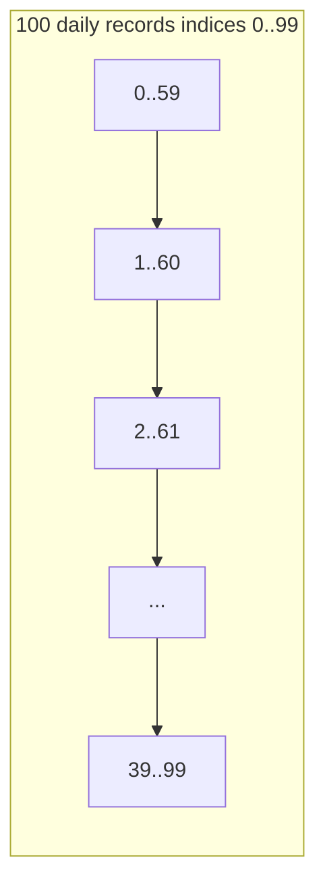

# 04 — Time-Series Preparation and Sequences

**THEORY + VERIFIED PROJECT CONTRACT.** All project statements are cited to source files.

---

## 4.1 Timestep and feature

| Term | Definition | In this project |
|---|---|---|
| **Timestep** | One index in the sequence dimension; one observation in time. | One trading session (one date for one symbol) |
| **Feature** | One measured variable at a timestep. | One of the 21 canonical columns |
| **Sequence length** | Number of timesteps per sample. | **60** (`scripts/lstm_data_pipeline.py` line 74) |
| **Sample** | One complete input window plus its label. | One `(60, 21)` matrix |

The tensor fed to the model has shape:

$$
\underbrace{\text{batch}}_{\text{N}} \times \underbrace{\text{time}}_{60} \times \underbrace{\text{features}}_{21}
$$

---

## 4.2 What `(None, 60, 21)` means (VERIFIED)

From `models/lstm_model.keras` `config.json` → `InputLayer.batch_input_shape = [None, 60, 21]`:

| Dimension | Meaning | Why |
|---|---|---|
| `None` | Batch size is dynamic | Allows 1 sequence in live prediction and many sequences in training |
| `60` | Fixed number of historical sessions | Architecture was built with 60 timesteps; every inference window must have exactly 60 |
| `21` | Fixed ordered feature vector per session | The original fitted scaler and first LSTM kernel assume 21 inputs in a fixed order |

Output `(None, 1)` = one probability per input sequence.

**Critical:** the model cannot accept 59 or 61 sessions, and cannot accept 20 or 22 features. `scripts/lstm_inference.py` lines 220–224 and 333–344 explicitly validate these shapes before predicting.

---

## 4.3 Why 60 sessions?

**VERIFIED framing:** 60 is the *configured* sequence length of the existing checkpoint (`models/lstm_metadata.json` line 36). There is no recorded hyperparameter search proving 60 is optimal.

**Reasonable justification (interpretation, not measured):**
- ≈ three trading months of context — enough to express short-term trend, momentum and volatility regimes.
- Long enough for the 26-period EMA/MACD and 20-period Bollinger/MA windows to be meaningful.
- Short enough to limit gradient path length and memory cost.
- Alpha Vantage's free "compact" endpoint returns roughly 100 rows, enough for 60 inputs plus indicator warm-up (`scripts/predict_lstm.py` lines 217–243).

Say: "60 was chosen in the original design and is fixed by the checkpoint; I did not measure that it is scientifically optimal."

---

## 4.4 Sliding-window generation (THEORY, then project)

Given $N$ ordered records and window length $L=60$, a standard sliding window creates:

$$
N_{\text{windows}} = N - L + 1
$$

windows: rows $[0..59], [1..60], \dots, [N-60..N-1]$. Consecutive windows overlap by 59 rows — this is deliberate, because it yields many training samples from one time series.

**Numerical example — hypothetical, $N=100$, $L=60$:**
- Naive windows: $100-60+1 = 41$ windows, ending at indices 59, 60, …, 99.
- With warm-up: indicators need leading history. From `scripts/lstm_data_pipeline.py` lines 140–172, the longest warm-up is EMA26 followed by a 9-period signal EMA → MACD_Signal first valid at roughly the 34th row (1-based), so only about $100-34+1-60+1 = 8$ fully valid windows remain.

Both numbers are illustrative; the project never hard-codes 41 or 8 — it drops incomplete rows and emits windows from valid rows only.

**Project implementation (VERIFIED):** `build_labeled_sequences()` in `scripts/lstm_data_pipeline.py` lines 226–323:
- Iterates per symbol, then per `Sequence_Block` (line 266).
- Drops rows with any non-finite feature (lines 270–271).
- For `end` from 59 to `len(block)-2` (line 281), takes `values[end-59 : end+1]` (line 290).
- In `legacy_binary` mode, skips labelled samples whose 3-class target is FLAT (lines 285–286), but FLAT rows can still appear inside other windows' inputs.
- Returns `X` shaped `(n, 60, 21)` and `y` shaped `(n,)` (lines 313–323).

---

## 4.5 Label alignment: the sequence ends at t, target is t → t+1

For a window containing rows $[t-59,\dots,t]$, the label is computed from the next session:

$$
\text{NextReturn}_t = \left(\frac{\text{Close}_{t+1}}{\text{Close}_t}-1\right)\times100
$$

Current pipeline (VERIFIED, `scripts/lstm_data_pipeline.py` lines 202–219):

- `Target = 2 (UP)` if NextReturn > +1%
- `Target = 1 (FLAT)` if −1% ≤ NextReturn ≤ +1%
- `Target = 0 (DOWN)` if NextReturn < −1%
- last row of a symbol → `Target = -1 (UNKNOWN)`, never used as a label

The earlier pipeline that produced the shipped checkpoint (`phase2_backup_20261124/feature_engineering.py` lines 196–213) used a binary version: `> +1% → 1 (UP)`, `< −1% → 0 (DOWN)`, and **dropped** neutral rows. Both map to the binary head's `0=DOWN, 1=UP`.

**Why the distinction matters:** a common viva mistake is saying "the model predicts the price at day t+1". It does not: it predicts the *direction class* of the return from t to t+1.

---

## 4.6 Inference: selecting the latest sequence (VERIFIED)

`scripts/predict_lstm.py` lines 151–179:

1. `prepare_symbol_frame(df, symbol)` validates OHLCV, parses dates, drops invalid/non-positive rows, sorts ascending, keeps the last duplicate date (lines 91–120 of `lstm_data_pipeline.py`).
2. `compute_technical_features(...)[FEATURE_COLUMNS].dropna()` removes warm-up rows.
3. Requires ≥ 60 valid rows (lines 168–175).
4. `sequence = df_feat.tail(60).values.astype(np.float32)` (line 177) — the **latest** 60 sessions.
5. `transform_sequences(scaler, sequence.reshape(1,60,21))` scales and clips to [0,1] (line 178; pipeline lines 412–420).
6. `model.predict(X)` yields $P(\text{UP})$ for the session after the last input date.

The Parquet path does the same with Spark-computed features (`scripts/lstm_inference.py` lines 617–638).

---

## 4.7 Gaps, blocks and per-symbol isolation (VERIFIED)

`prepare_symbol_frame()` tags a new `Sequence_Block` whenever the calendar gap between consecutive valid dates exceeds 7 days (`scripts/lstm_data_pipeline.py` lines 116–118). Sequences never cross a block boundary (line 266).

At inference, `preflight_symbol()` (`scripts/lstm_inference.py` lines 369–450) checks the last 60 rows:
- more than one block **and** a gap > 30 days → prediction blocked;
- smaller gaps → warning only;
- fewer than 60 complete feature rows → blocked.

This prevents silently bridging missing history.

**Why no cross-symbol windows:** a window mixing AAPL and MSFT rows would fabricate a non-existent time series. Every function partitions by `Symbol` first (`split_frames_by_symbol()`, lines 423–428).

---

## 4.8 Why feature ordering must remain consistent

The first LSTM kernel has shape `(21, 512)`. Column $j$ of that kernel corresponds to feature $j$ at every timestep. If `Volume` and `Close` were swapped, the weights would interpret volume as price. The scaler's `data_min_`/`scale_` arrays are also position-indexed.

Consistency is enforced in three places:
1. `scripts/model_config.py` lines 28–50 — canonical list; `validate_feature_schema()` lines 71–77 raises on mismatch.
2. `scripts/lstm_inference.py` lines 185–195 — cross-checks metadata, config and pipeline at startup; raises `ValueError` if they disagree.
3. `scripts/spark_live_processing.py` lines 258–333 + `validate_spark_features()` lines 336 onwards — Spark emits and validates the same names.

---

## 4.9 Batch dimension in training vs inference

| Context | Batch size | Tensor shape |
|---|---|---|
| Training | 32 (metadata line 53) | `(32, 60, 21)` per mini-batch |
| Single-stock live inference | 1 | `(1, 60, 21)` |
| Multi-stock inference | one symbol at a time in a loop | `(1, 60, 21)` each |
| Audit sanity check | 2 | `(2, 1)` output |

Because the first dimension is `None`, the same model handles all of them.

---

## 4.10 Viva questions and answers

**Q1. What does a timestep mean in your model?**
One trading session; 60 of them form one input sample.

**Q2. What does `(None, 60, 21)` mean?**
Dynamic batch size, 60 timesteps, 21 ordered features per timestep.

**Q3. Why must the sequence length be exactly 60?**
The checkpoint's InputLayer was built with 60; a different count violates the saved architecture and is rejected by validation code.

**Q4. Why is the batch dimension `None`?**
It lets the same model serve batch training (32), single-stock inference (1) and test batches.

**Q5. How are overlapping sequences created?**
By sliding a 60-row window one row at a time across valid rows; each window shares 59 rows with the next.

**Q6. For 100 records, how many windows do you get?**
41 naively ($100-60+1$); fewer after discarding indicator warm-up rows (about 8 with this feature set). These are illustrative numbers.

**Q7. Why not shuffle the data before splitting?**
Shuffling leaks future information. The project splits chronologically (`chronological_80_20` recorded; current code uses 70/15/15 by target date).

**Q8. What is a `Sequence_Block`?**
A contiguous segment of a symbol's history; a calendar gap > 7 days starts a new block, and windows never cross blocks.

**Q9. How is the latest sequence chosen for prediction?**
`df_feat.tail(60)` after validation, warm-up removal and sorting.

**Q10. What label does a window ending at t have?**
The direction of the return from t to t+1: DOWN (<−1%), FLAT (±1%), UP (>+1%) in the current 3-class definition; the deployed binary model uses UP/DOWN only.

**Q11. Does the model see the target column?**
Never. `NON_FEATURE_COLUMNS` excludes `Target`, `Target_Date` and `Next_Return_Pct`.

**Q12. What happens if a feature is missing?**
Preflight blocks inference with an explicit error; no imputation or fabricated value is used.

**Q13. Does the model mix different stocks in one sequence?**
No. Frames are split by symbol before windowing.

**Q14. Why can't a manual single-row snapshot be used with the LSTM?**
It lacks 59 prior sessions. Metadata explicitly marks the model as `live_mode_only` for this reason.

**Q15. (Tricky) Is 60 days enough for long-term trends?**
It covers roughly a quarter, not years. It is a design choice, not a proven optimum.

**Q16. (Tricky) If you fed 61 rows, what would happen?**
The reshape to `(1,61,21)` would fail the model's `(None,60,21)` contract; validation would reject it.

**Q17. (Tricky) Are overlapping windows a form of data leakage?**
Not if the split is chronological by target date. Overlap inside a partition is acceptable; overlap across train/test boundaries is not, which is why the current code assigns by target date.

**Q18. (Tricky) Why does `tail(60)` use the last available date, not today's date?**
Because market data may be delayed; the model predicts the session after the last *available* session, and the record stores that input date explicitly.

**Q19. (Tricky) What is the difference between a warm-up row and a gap?**
Warm-up rows exist but lack valid indicator values (e.g. RSI needs 14 days); a gap is a missing date range. Both are handled separately.

**Q20. How does Spark parity work?**
`spark_live_processing.py` computes the same 21 canonical columns with per-symbol windows; `predict_from_features()` consumes that Parquet data through the same scaler and model.
