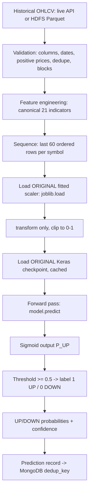

# 07 — Model Training vs Inference

**THEORY** for training; **VERIFIED** for what this project actually runs.

---

## 7.1 The theoretical training loop

```mermaid
graph TD
    A[Training sequences X, y] --> B[Forward propagation]
    B --> C[Predictions ŷ]
    C --> D[Loss L = BCE(y, ŷ)]
    D --> E[Backpropagation through time]
    E --> F[Gradient of L w.r.t. weights]
    F --> G[Optimizer step: Adam updates weights]
    G --> B
    B --> H{Epoch complete?}
    H -->|No| B
    H -->|Yes| I[Validate on val set]
    I --> J{Early stopping / LR schedule}
    J -->|best val_loss| K[Save checkpoint]
    J -->|continue| B
    K --> L[Final evaluation on test set]
```

1. **Forward propagation:** $z = \mathbf{W}a+b$, $a=\phi(z)$, ending in $\hat y=\sigma(\cdot)$.
2. **Loss:** binary cross-entropy $-\frac1N\sum[y\log\hat y+(1-y)\log(1-\hat y)]$.
3. **BPTT:** chain rule across 60 unrolled timesteps; the additive cell state preserves gradients.
4. **Weight update:** $w \leftarrow w - \eta\,\partial\mathcal{L}/\partial w$; Adam adapts per-parameter learning rates using momentum and second-moment estimates ($\beta_1=0.9$, $\beta_2=0.999$, $\epsilon=10^{-7}$ in this checkpoint).
5. **Epochs / batches:** repeats over mini-batches of 32.
6. **Validation:** monitors `val_loss`, drives early stopping (patience 7) and learning-rate reduction (factor 0.5, patience 3).
7. **Checkpointing:** `ModelCheckpoint(save_best_only=True, monitor='val_loss')` writes `models/lstm_model.keras`.
8. **Test evaluation:** computed once on the untouched chronological test set; metrics written to metadata.

---

## 7.2 Training configuration: recorded vs current code

| Item | Shipped checkpoint's run (recorded/backup evidence) | Current `scripts/train_lstm_model.py` |
|---|---|---|
| Epochs | 30 configured, 29 trained | 30 (line 90) |
| Batch size | 32 | 32 (line 91) |
| Initial LR | 0.001 recorded; checkpoint stores 0.00025 | 0.001 (line 92) |
| Loss / metric | binary_crossentropy / accuracy | same (lines 194–198) |
| Split | `chronological_80_20`, 5 stable symbols | per-symbol chronological 70/15/15, all eligible symbols (lines 81–88, 151–162) |
| Scaler fit | On all rows before split (backup lines 394–398) — leakage risk | On training partition only (lines 409–423) |
| Label mode | Binary UP/DOWN, neutral rows dropped | `legacy_binary` (line 88) with FLAT rows retained in windows but skipped as labels |
| Callbacks | EarlyStopping patience 7, ReduceLROnPlateau patience 3 factor 0.5, ModelCheckpoint | same (lines 216–236) |

**Conclusion:** the deployed model came from the earlier pipeline (preserved in `phase2_backup_20261124/`). The current trainer is a refactor that has **not been rerun** after those changes — the on-disk metadata still has the old schema. Do not attribute the shipped checkpoint to the current file.

---

## 7.3 The exact inference lifecycle (VERIFIED)



### Step-by-step with file evidence

| Step | Implementation |
|---|---|
| 1. Data source | `fetch_live_data.fetch_yfinance` / `fetch_alpha_vantage` (`predict_lstm.py` lines 222–243) or Spark Parquet (`stock_intelligence_pipeline.py` lines 567–589) |
| 2. Validation | `prepare_symbol_frame()` (`lstm_data_pipeline.py` lines 91–120); `preflight_symbol()` (`lstm_inference.py` lines 369–450) |
| 3. Features | `compute_technical_features()` (`lstm_data_pipeline.py` lines 127–199) |
| 4. Sequence | `df_feat.tail(60)` (`predict_lstm.py` line 177) or Parquet `valid_frame.tail(60)` (`lstm_inference.py` line 637) |
| 5. Scaler | `joblib.load()` cached (`predict_lstm.py` lines 110–129) |
| 6. Transform | `transform_sequences()` — `scaler.transform()` + clip (`lstm_data_pipeline.py` lines 412–420) |
| 7. Model | `keras.models.load_model()` cached (`predict_lstm.py` lines 79–107); artifact discovery validates shapes (`lstm_inference.py` lines 145–311) |
| 8. Predict | `model.predict(X, verbose=0)` (`predict_lstm.py` line 255; `lstm_inference.py` lines 510, 651) |
| 9. Threshold | `>= 0.5` → UP (`predict_lstm.py` line 256; `lstm_inference.py` lines 541, 674) |
| 10. Record | probabilities, confidence, timestamps, model hash, feature config (`lstm_inference.py` lines 457–470, 539–563, 805–851) |

---

## 7.4 Why inference does not update weights

- `model.predict()` performs forward computation only; gradient tapes are not used.
- Dropout is disabled at inference; no stochastic regularisation.
- No optimizer step is called anywhere in `predict_lstm.py` or `lstm_inference.py`.
- **Verified empirically:** during the read-only audit, all weight arrays were copied before `predict()` and compared after — **no weight changed**.
- The model and scaler are cached (`_LSTM_MODEL_CACHE`, `_LSTM_SCALER_CACHE`) so repeated predictions reuse the same objects.

---

## 7.5 Artifact discovery and safety guards (VERIFIED)

`lstm_inference.discover_artifacts()` (lines 145–311):

- reads `.keras/config.json` with `zipfile` **without importing TensorFlow** (lines 127–142);
- verifies all three artifacts exist, refusing to create substitutes (lines 166–179);
- cross-checks feature order across metadata, `model_config` and pipeline (lines 185–195);
- extracts `InputLayer.batch_input_shape`, last `Dense` units and activation (lines 197–215);
- enforces `(60, 21)` input and single sigmoid output (lines 220–241);
- loads the scaler with `joblib.load()` and checks type, 21 features and (0,1) range (lines 243–259);
- records SHA-256 of the model file (line 261);
- reports capabilities `direction_binary=True`, `three_class=False`, `next_session_return=False` (lines 302–306).

`load_bundle()` (lines 322–345) re-validates the *loaded* model's shapes before returning it.

---

## 7.6 Multi-stock and ingestion paths (VERIFIED)

- `infer_symbols()` (lines 762–798) loads the model/scaler once and loops over symbols; a failure for one symbol does not abort the batch.
- `predict_from_features()` (lines 567–707) consumes authoritative Spark-processed Parquet rows, validates exact 21-column schema, sorts by date, takes the last 60 rows and applies the same scaler and model.
- `phase2` data preprocessing (`scripts/preprocessing.py` lines 105–130) forward-fills within symbols and drops remaining NaNs.
- Storage record includes `model_sha256`, input timestamp and feature-config hash so a prediction is bound to the exact weights and schema that produced it (`lstm_inference.py` lines 805–851).

---

## 7.7 Viva questions and answers

**Q1. What is backpropagation through time?**
Backpropagation applied to the RNN unrolled over timesteps; gradients flow through each of the 60 steps.

**Q2. Which optimizer was used and what learning rate is in the checkpoint?**
Adam; the checkpoint stores 2.5e−4, metadata records a configured 1e−3.

**Q3. What loss was minimised?**
Binary cross-entropy.

**Q4. Why monitor validation loss rather than test loss?**
Test data must remain untouched for an unbiased final estimate; validation drives early stopping and checkpoint selection.

**Q5. What is early stopping and what patience was configured?**
Stop when validation loss stops improving; patience 7 with best-weight restoration.

**Q6. What is ModelCheckpoint doing?**
Saves the model whenever validation loss improves; hence the saved model holds the best weights, not necessarily the last epoch's.

**Q7. How many epochs were actually trained?**
29 of 30 configured (metadata lines 51–52; 29 entries in `lstm_history.json`).

**Q8. What is the difference between training and inference here?**
Training updates weights via BPTT; inference only loads artifacts, transforms input and calls `predict()`.

**Q9. Does inference ever call `fit()` on the scaler?**
Never. Loading is `joblib.load()`, transformation is `transform()` only.

**Q10. How do you know inference did not change the model?**
The code never calls training APIs, and the audit compared all weight arrays before and after `predict()` — identical.

**Q11. Why cache the model and scaler?**
To avoid repeated disk I/O and Keras load overhead for every symbol.

**Q12. What happens if the checkpoint is missing?**
`discover_artifacts()` raises `FileNotFoundError` with an explicit "refusing to create a replacement model" message.

**Q13. What does the artifact SHA-256 achieve?**
It identifies the exact weights used for a prediction and is included in the MongoDB dedup key.

**Q14. What is the difference between the live and Parquet inference paths?**
Live recomputes features from OHLCV with pandas; Parquet consumes already-computed Spark features. Both end at the same scaler and model.

**Q15. Why is the model `live_mode_only` in deployment notes?**
It needs 60 past sessions; a manual single-row snapshot cannot provide them.

**Q16. Was the current training script used to create the deployed model?**
No. Evidence: metadata schema and 80/20 split match the backup script, not the current 70/15/15 refactor.

**Q17. What is a data leak in this project's history?**
The earlier trainer fitted MinMaxScaler on all rows before splitting; the current code fixes that.

**Q18. Why is the recorded accuracy not recalculated at inference?**
Runtime predictions have no labels; the dashboard reads metrics from metadata (`app.py` line 320).

**Q19. (Tricky) ModelCheckpoint saved the best validation loss, but metadata reports test accuracy. Are these the same evaluation?**
No. `val_loss` selects the checkpoint; test metrics are computed afterwards on a separate partition.

**Q20. (Tricky) Does `ReduceLROnPlateau` change the model architecture?**
No — only the optimizer's learning rate. That explains the 0.00025 stored in the checkpoint.

**Q21. (Tricky) If you delete the scaler but keep the model, can you still predict?**
No. The pipeline refuses to run and reports the missing artifact.

**Q22. (Tricky) Could you fine-tune the model on live data in this pipeline?**
Not without new code; no training calls exist in the inference modules, and doing so would change the deployed weights.
